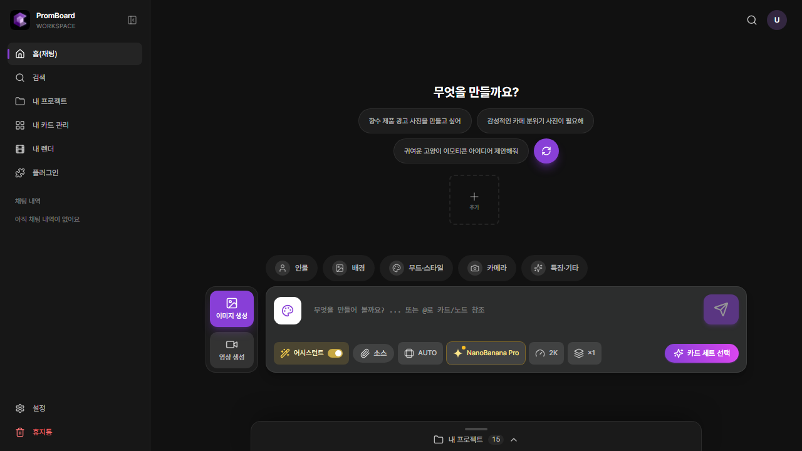

# PromBoard 설치 파일

PromBoard 데스크톱 앱(윈도우 · 맥)의 설치 파일을 올리는 곳입니다. 전문용어 카드를 눈으로 골라 AI 이미지 · 영상을 만드는 로컬 설치형 프로그램입니다. 이 저장소에는 소스 코드가 없습니다.

## 받기

[최신 설치 파일 (Releases)](https://github.com/promboard-app/releases/releases/latest)

| 운영체제 | 파일 |
|---|---|
| 윈도우 (64비트) | `PromBoard-Setup-<버전>-win-x64.exe` |
| 맥 (애플 칩) | `PromBoard-<버전>-mac-arm64.dmg` |

## 업데이트

앱을 늘 최신 버전으로 써 주세요. 앱은 켤 때마다 이 저장소에서 새 버전을 확인합니다.

- 윈도우: 새 버전을 알아서 받아 두고, 앱을 다시 시작하면 바뀝니다.
- 맥: 새 버전이 있으면 알려 줍니다. 위 링크에서 새 설치 파일을 받아 덮어 설치해 주세요. 만든 것과 키는 그대로 이어집니다.

`latest.yml` · `.blockmap` 파일은 윈도우 자동 업데이트가 읽는 파일이니 받지 않아도 됩니다.
